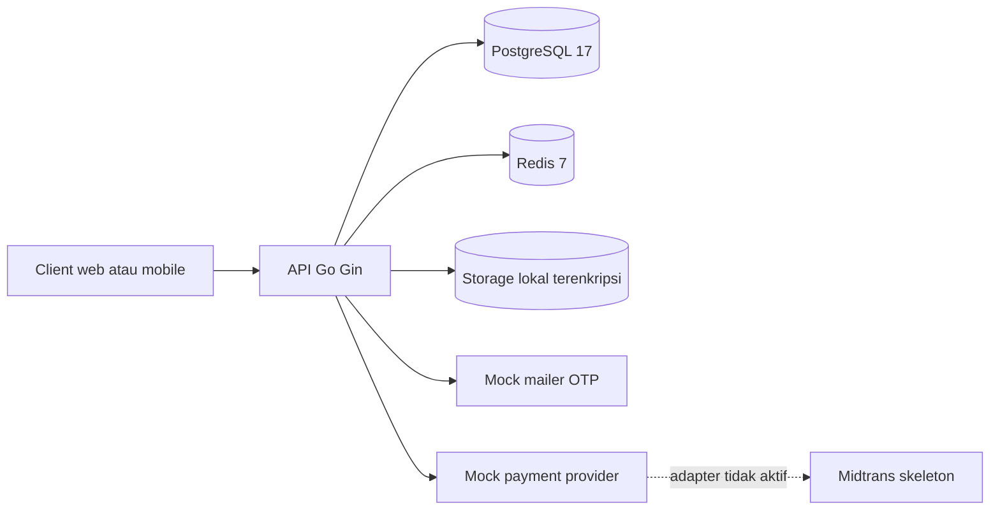
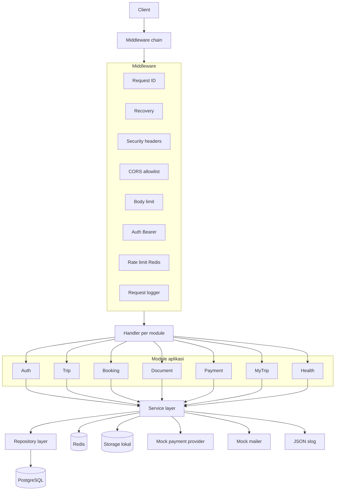
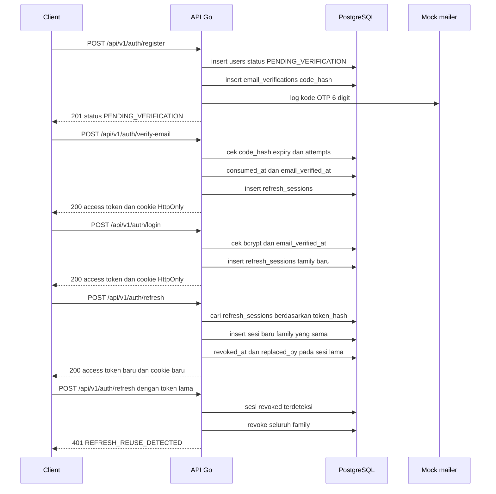
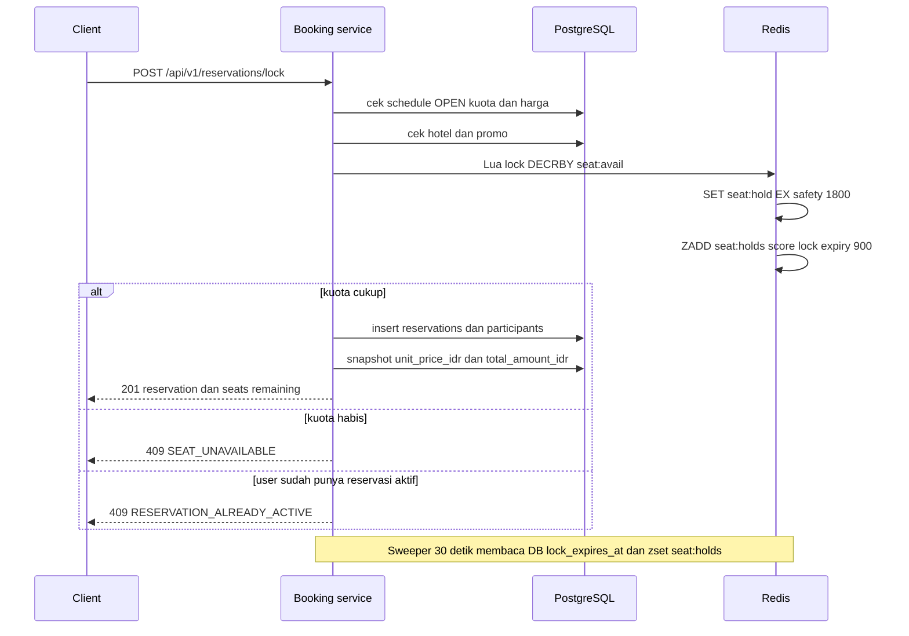
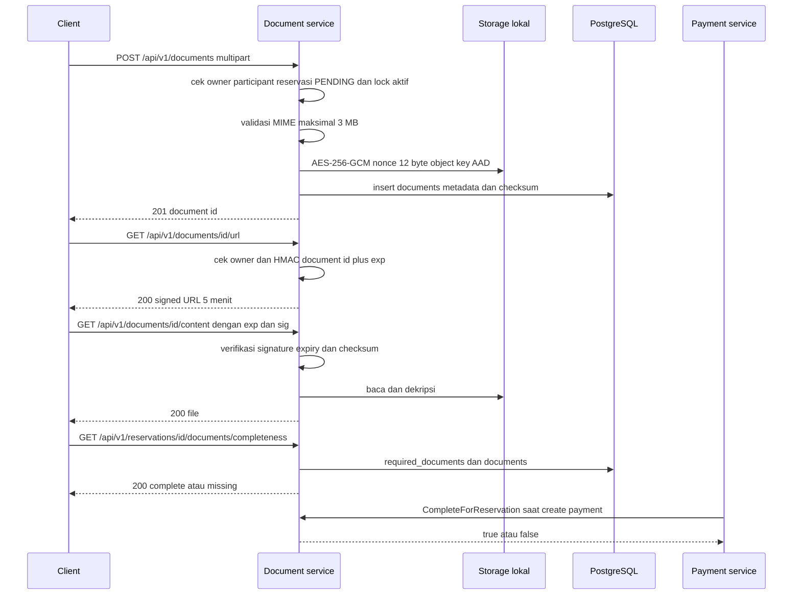
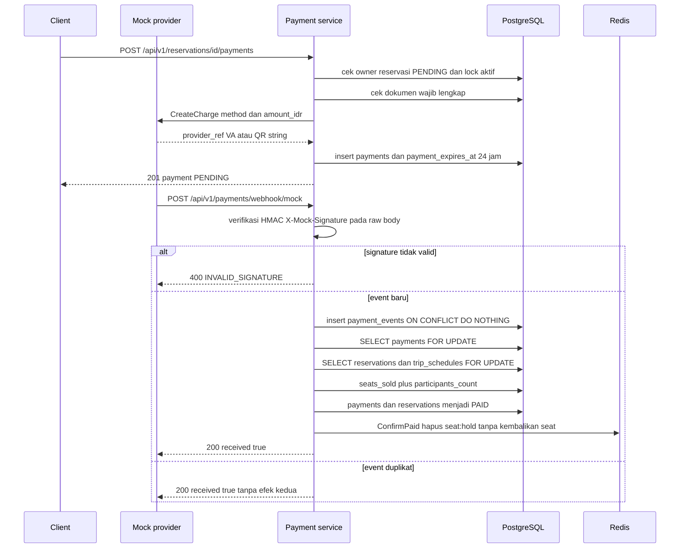
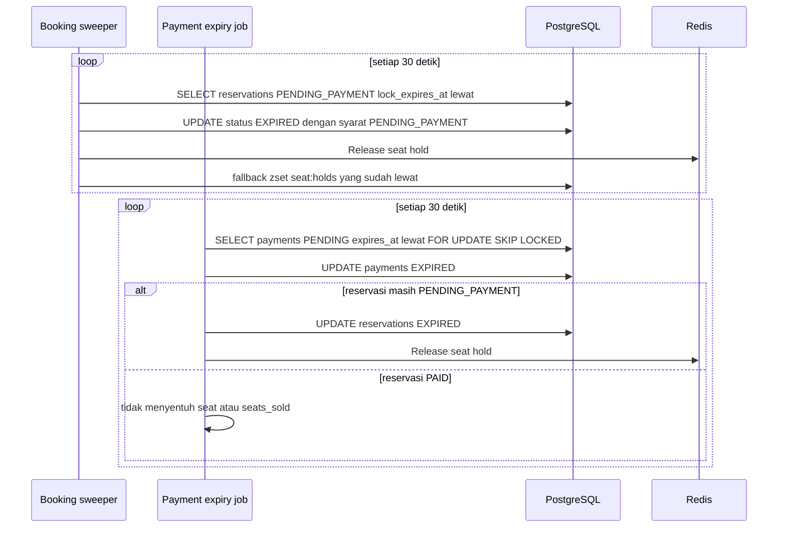
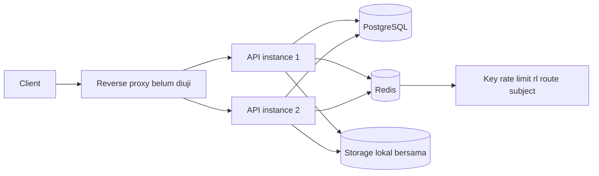

# Arsitektur Backend Kelana

Dokumen ini menggambarkan arsitektur dan alur bisnis backend Kelana sesuai kode di repository. Nama route, key Redis, tabel, dan package diverifikasi langsung dari kode; sumbernya dicantumkan di bagian akhir.

## 1. Konteks sistem

Klien frontend belum ada. API berjalan sebagai satu binary Go dan memakai PostgreSQL untuk data transaksi, Redis untuk seat hold dan rate limit, storage lokal untuk file dokumen terenkripsi, serta provider payment mock.

## 2. Diagram komponen

Aturan dependensi: handler memanggil service, service memanggil repository atau port infra. Module `mytrip` memakai query read-only sendiri dan mendelegasikan cancel ke booking melalui port `Canceller`. Module `health` tidak memiliki tabel.

## 3. Peta module dan tanggung jawab

| Module | Tanggung jawab | Tabel yang dimiliki atau dibaca | Sumber utama |
|---|---|---|---|
| auth | register, OTP email, verifikasi, login, refresh rotation, logout, profil | `users`, `email_verifications`, `refresh_sessions` | `internal/module/auth` |
| trip | discovery, filter, detail, jadwal, destinasi, kategori | `trips`, `trip_schedules`, `trip_itineraries`, `trip_facilities`, `hotels`, `trip_hotels` | `internal/module/trip` |
| booking | seat lock, reservasi, peserta, promo, cancel | `reservations`, `participants`, `promo_codes`, `promo_redemptions` | `internal/module/booking` |
| document | upload, validasi, enkripsi, metadata, signed URL, hapus | `documents` | `internal/module/document` |
| payment | create charge, webhook HMAC, idempotency, transisi PAID, expiry payment | `payments`, `payment_events` | `internal/module/payment` |
| mytrip | read model reservasi, peserta, payment, dokumen, WA gating, timer, cancel | membaca `reservations`, `trips`, `trip_schedules`, `payments`, `participants`, `documents` | `internal/module/mytrip` |
| health | liveness dan readiness PostgreSQL/Redis | tidak ada | `internal/module/health` |

## 4. Alur bisnis

### 4.1 Register, OTP, login, dan refresh rotation

Login sebelum verifikasi ditolak `403 EMAIL_NOT_VERIFIED`. Access token adalah JWT HS256; refresh token disimpan sebagai hash dan dikirim sebagai cookie HttpOnly. Reuse token lama mencabut seluruh family sesi.

### 4.2 Lock kursi dan seat hold Redis

Key Redis yang dipakai:

| Key | Tipe | Fungsi |
|---|---|---|
| `seat:avail:{scheduleID}` | string integer | sisa seat yang belum di-hold dan belum terjual |
| `seat:hold:{reservationID}` | string integer | jumlah seat yang di-hold, TTL safety 1800 detik |
| `seat:holds:{scheduleID}` | sorted set | member reservationID, score unix expiry lock 900 detik |

Operasi lock, release, dan confirm-paid dijalankan sebagai Lua atomik. `payments` tidak pernah mengubah harga snapshot reservasi.

### 4.3 Upload dokumen, signed URL, dan gate kelengkapan

File disimpan di `UPLOADS_DIR/documents/reservations/{reservationID}/{documentID}.enc`. Nonce 12 byte ditulis di awal file, object key menjadi AAD, dan checksum SHA-256 plaintext disimpan di tabel `documents`. Tidak ada static route ke folder upload.

### 4.4 Payment create, webhook HMAC, dan transisi PAID

Idempotency webhook memakai unique `payment_events(provider, provider_event_id)`. Signature diverifikasi sebelum repository menyentuh database. Payment PAID tidak mengembalikan seat; `seats_sold` permanen.

### 4.5 Expiry job reservasi dan payment

Kedua job idempoten: update memakai kondisi status, sehingga run berikutnya tidak mengembalikan seat dua kali. Reservasi yang sudah PAID tidak memenuhi filter expiry.

## 5. Topologi deployment

Satu binary API dapat dijalankan beberapa instance. Seat hold, rate limit, dan cooldown berbagi Redis; data transaksi berbagi PostgreSQL. Storage lokal memerlukan volume bersama bila instance lebih dari satu. Reverse proxy, TLS, dan header `X-Forwarded-*` belum diuji.

Key Redis untuk pembatas dan cooldown:

| Key | Fungsi |
|---|---|
| `rl:<route>:ip:<clientIP>` | fixed window rate limit per IP |
| `rl:<route>:user:<userID>` | fixed window rate limit per user |
| `cd:otp-resend:<email>` | cooldown kirim ulang OTP 15 detik |

## 6. Batasan dan keputusan kunci

| Topik | Keputusan |
|---|---|
| Uang | Semua nominal integer rupiah memakai field `*_idr`; tidak ada float untuk uang |
| Waktu | Database menyimpan UTC; tampilan dan tab mytrips memakai WIB |
| OTP | Mail driver mock menulis kode OTP ke log server; tidak mengirim email nyata |
| Payment | Mock provider aktif; adapter Midtrans adalah skeleton dan tidak didaftarkan di DI |
| Refund | Mock mengembalikan `ErrNotSupported`; belum ada endpoint refund |
| Dokumen | Storage lokal AES-256-GCM; S3 belum diimplementasikan |
| Frontend | Belum ada; API dipakai klien web atau mobile di masa depan |
| Rate limit | Redis fixed window lintas instance; limit saat ini hardcoded di handler |
| Cancel | Sebelum bayar boleh; setelah PAID ditolak `409 ALREADY_PAID` |
| WA | `join_wa_url` hanya ada untuk reservasi PAID |

## 7. Verifikasi nama dari kode

| Yang diverifikasi | File sumber |
|---|---|
| Route health, auth, trip, booking, document, payment, mytrip | `internal/api/router.go`, `internal/module/*/handler/handler.go` |
| Key dan operasi Lua seat hold | `internal/infra/redis/seathold.go` |
| Key rate limit dan cooldown | `internal/infra/ratelimit/limiter.go`, `internal/module/auth/handler/handler.go` |
| Tabel auth | `internal/infra/database/migration/00001_init_auth.sql` |
| Tabel trip dan jadwal | `internal/infra/database/migration/00002_init_trips.sql` |
| Tabel promo, reservasi, peserta | `internal/infra/database/migration/00003_init_promos.sql`, `00004_init_booking.sql` |
| Tabel payment dan event | `internal/infra/database/migration/00005_init_payments.sql` |
| Tabel dokumen | `internal/infra/database/migration/00007_init_documents.sql` |
| Alur lock dan expiry reservasi | `internal/module/booking/service/service.go`, `internal/module/booking/repository/repository_impl.go` |
| Alur dokumen dan completeness | `internal/module/document/service/service.go`, `internal/module/document/handler/handler.go` |
| Alur payment dan webhook | `internal/module/payment/service/service.go`, `internal/module/payment/repository/repository_impl.go` |
| Alur mytrip dan WA gating | `internal/module/mytrip/service/service.go`, `internal/module/mytrip/repository/repository_impl.go` |
| Middleware keamanan dan CORS | `internal/api/middleware/*.go` |
| Konfigurasi TTL dan limit | `internal/config/config.go`, `internal/api/middleware/rate_limit.go` |

Dokumen ini tidak mengubah kontrak API. Kontrak lengkap ada di `internal/api/openapi.json` dan disajikan di `GET /openapi.json`.